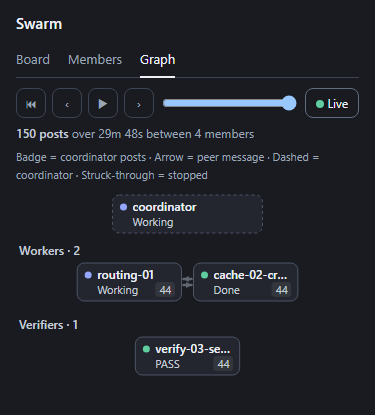
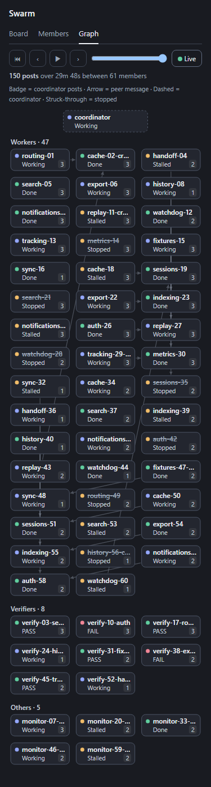

# dsh-swarm

A local **Swarm** mode plugin for the [DeepSeek Harness](https://github.com/deepseek-ai/deepseek-harness) desktop app: a lead coordinator splits a task into independent slices, launches parallel workers (each in its own Git worktree and branch when working in a Git repository), verifies every slice with a fresh read-only verifier, merges branches back cleanly, and surfaces the whole run in a dedicated **Swarm** side pane.

The workflow and side-pane UX are inspired by Google Antigravity's `/swarm`.



## What the Swarm pane shows

The plugin adds a **Swarm** tab in DeepSeek Harness's right sidebar (plus a header status button that auto-opens the pane once workers start and follows you when you inspect a worker's chat):

- **Header meters:** live/finished indicator, coordinator context window bar (`compact soon` / `compact now` thresholds), and estimated session cost & total tokens across all agents.
- **Board:** unified message feed (`swarmBoard` projection) showing user prompts, delegation briefs, peer `send_message` relays, verifier verdicts (`PASS` / `FAIL`), and closing reports in exact timestamp order, with search, member filter, and a `Follow` toggle.
- **Members:** coordinator plus Active / Standing by / Retired groups with model, reasoning effort, token/time/cost totals, passive stall detection (`swarmVitals` flags running members silent or stuck on an open tool call for >5 min), and last error. Click any member to open its conversation.
- **Graph:** coordinator on top, members grouped by role (workers, verifiers, others) in a grid that grows downward, so it stays readable from 3 to 100+ agents in a narrow pane. Each card shows status and its message count with the coordinator; arrows are kept for peer-to-peer messages. Step/play/scrub replay highlights the sender and every recipient of each post, and `Live` returns to the current state.



## Requirements

- **DeepSeek Harness** desktop app with `@deepseek-ai/cordis` `>=4.0.4 <5.0.0` (tested on DeepSeek Harness `0.2.2-rc.3` with `@deepseek-ai/dsh-experimental-worktree` `0.2.2-rc.3`).
- **Node.js** on `PATH` (used to run tests, pack the tarball, and by DSH's worktree runtime to allocate worktree directories).
- **Git** on `PATH` with `user.name` and `user.email` configured (required for worktree mode; the lead and workers never run `git config`).
- **Provider access:** the worker, verifier and monitor presets use the `opencode-go` provider with `deepseek-v4.1-flash`. That provider comes from the community plugin [dsh-llm-opencode-go](https://github.com/NOirBRight/dsh-llm-opencode-go) and needs an OpenCode Go account. To use another provider, change `provider` / `model` in [cordis.patch.yml](cordis.patch.yml).
- **Do not combine with DSH's "Change requests & worktrees" (forge) bundle:** both register the `worktree` service row.

## Build and install

### 1. Pack the plugin tarball

From the repo root, using Node (cross-platform):

```bash
node scripts/pack.mjs
```

Or on Windows PowerShell:

```powershell
./scripts/pack.ps1
```

Both commands write `./dist/dsh-swarm-<version>.tgz` (pass an optional output directory argument to override `./dist`).

### 2. Install into DeepSeek Harness

1. **Open DeepSeek Harness once**, so it creates its `desktop` profile (`dsh plugin` refuses to run until it exists), then **quit it completely**.
2. **Install the `.tgz`** with the `dsh` CLI that ships inside the app. It is not on `PATH`; on Windows it is `<DeepSeek Harness install folder>\resources\runtime\cli\bin\dsh.cmd`.

   ```powershell
   # Only if you use a non-default data directory:
   $env:DSH_HOME = "<path-to-your-dsh-home>"

   & "<DeepSeek Harness install folder>\resources\runtime\cli\bin\dsh.cmd" plugin --profile desktop add "file:<path-to-repo>/dist/dsh-swarm-0.5.0.tgz"
   ```

   Use forward slashes in the `file:` URL (spaces in the path are fine inside the quotes). On macOS/Linux, run the same `dsh plugin ...` command with the CLI from your install.
3. **Turn the bundle on.** `plugin add` installs the package but does not enable it. Open `<DSH_HOME>/profiles/desktop/package.json` and add `"dsh-swarm"` to `dsh.profile.bundles`:

   ```json
   "dsh": { "profile": { "bundles": [ "...your existing bundles...", "dsh-swarm" ] } }
   ```

4. **Start DeepSeek Harness.** **Swarm** now appears in the mode picker.

**Install notes:**

- **Harmless `ERR_PNPM_IGNORED_BUILDS` warning:** `pnpm` may exit with code `1` and report `ERR_PNPM_IGNORED_BUILDS` (for example on `@google/genai` or `protobufjs`). This is harmless — the `dsh-swarm` copy is still installed.
- **Always install from the `.tgz`, not a symlink/link:** a linked install cannot resolve `@deepseek-ai/*` runtime modules, and `pnpm remove` follows links.
- **After upgrading:** host (`lib/index.js`) or `cordis.patch.yml` changes require a full app restart; client-only (`lib/client.js`) changes take effect after reloading the window (`Ctrl+R`).
- **To disable or remove:** remove `dsh-swarm` from your profile's bundles (or run `dsh plugin --profile <profile> remove dsh-swarm` while the app is closed).

## How to start a swarm

1. Open DeepSeek Harness in your project folder.
2. Pick **Swarm** in the mode picker.
3. Describe the task and send your message.

At the start of a run, the lead checks the repository state:

- **GIT mode** (default when opened at the root of a Git repo on a branch with a clean tree — or after you approve a baseline commit): each worker calls `create_worktree` to work on its own branch under `.agents/worktrees/<worker-name>` (added to `.git/info/exclude`), commits its slice, gets checked in its worktree by a fresh verifier, and once every slice passes, the lead merges each branch with `git merge --no-ff`, runs a final fresh verifier on the merged tree, and removes the worktrees and branches without force flags.
- **SHARED mode** (not a Git repo, subdirectory of a larger repo, detached `HEAD`, empty repo, or you decline a baseline commit): workers edit disjoint files in the shared folder and are verified in groups.

The Swarm side pane opens automatically when workers start and can be toggled any time from the **Swarm** button in the session header.

## Model and effort defaults

Configured in [cordis.patch.yml](cordis.patch.yml):

| Role | Preset ID | Provider | Model | Reasoning effort | Notes |
|---|---|---|---|---|---|
| Lead | `swarm-lead` | Session default | Session default | Session default | Uses `agent-default-model` (recommended: `deepseek-v4.1-flash`, `max`) |
| Worker | `swarm-worker` (`delegate_worker`) | `opencode-go` | `deepseek-v4.1-flash` | `high` | One per disjoint slice; owns `create_worktree` |
| Verifier | `swarm-verifier` (`delegate_verifier`) | `opencode-go` | `deepseek-v4.1-flash` | `max` | Fresh verifier per check; filesystem write/edit tools disabled |
| Monitor | `swarm-monitor` (`delegate_monitor`) | `opencode-go` | `deepseek-v4.1-flash` | `low` | Started for 3+ slices; waits 5 min (`timeout_ms: 300000`) and pings on stalls |

Up to 8 sub-agents can be active concurrently (DSH default). To use another provider, model, or effort level, edit the `agentOptions` blocks at the bottom of [cordis.patch.yml](cordis.patch.yml), bump `version` in [package.json](package.json), repack, and reinstall.

> The pane's session cost figure is an estimate based on OpenCode Zen pay-as-you-go list prices for `deepseek-v4.1-flash` ($0.30 input, $0.006 cache read, $0.30 cache write, $1.20 output per 1M tokens). Flat-plan users consume quota instead.

## Known limits

- **Forced merge-conflict recovery is untested live:** step 8b (`git merge --abort` → conflict-fix worker → verify → merge) has not yet been exercised in a live run.
- **Worktree containment and shell read-only rules are prompt-only:** DeepSeek Harness mounts `working_directory` globally and has no per-preset/per-child sandbox-mode override. Filesystem write/edit tools are disabled for the lead and verifiers, but restricting shell writes and preventing `cd` out of a worktree rely on persona instructions.
- **Worktrees contain tracked files only:** `create_worktree` checks out the base commit without copying untracked or git-ignored files (`node_modules`, `.env`, local build outputs). Projects whose tests depend on untracked installs must install them inside the worktree or keep tests dependency-free.
- **Worktree edge cases are code-checked only:** non-force `git worktree remove` refusal on dirty/untracked files, `retainOnArchive: false` archive cleanup, simultaneous `create_worktree` name collisions (DSH does not serialize creation), restarted workers hitting an existing branch name, and reporting pre-existing leftover worktrees/branches have not been hit live yet.
- **The 0.5.0 Graph layout is tested in a standalone React harness and unit tests, not yet inside the app.**
- **0.4.1 prompt refinements have not run live yet:** `0.4.0` was proven live end-to-end (parallel worktrees, commits, fresh verifiers, `git merge --no-ff`, cleanup); `0.4.1` added the `git worktree list` / `git branch --list` end-state proof and worker scratch-cleanup rules on top.
- **Internal presets appear in the mode picker:** DSH presets do not support a hidden flag, so `Swarm: worker`, `Swarm: verifier`, and `Swarm: monitor` appear at the bottom of the picker (`order` 90–92). Always start a run with **Swarm**.
- **DSH preview API drift:** DeepSeek Harness is a developer preview; config/projection shapes may change across releases.

## Running tests

All tests are self-contained (zero dependencies, synthetic fixtures only) and run with Node's built-in test runner:

```bash
node --test
```

## License

[MIT](LICENSE)
